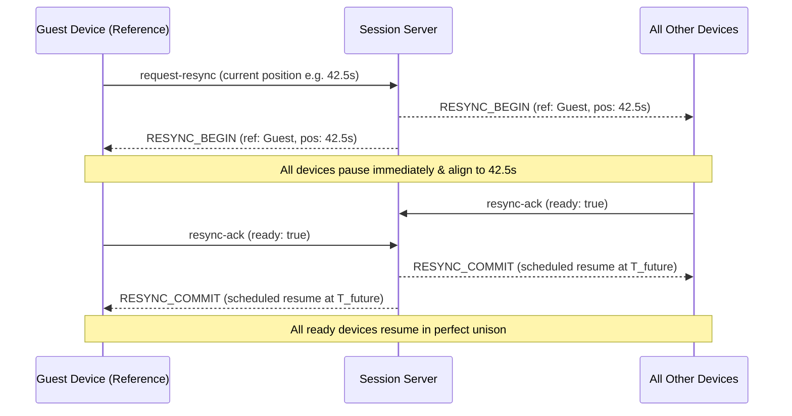

# SyncBeat — Architecture, Deployment & User Guide

SyncBeat turns a group of phones, laptops, and desktop computers into a shared, synchronized speaker system.

---

## 1. System Architecture

SyncBeat operates in **two flexible modes**:

```
                       ┌──────────────────────────────┐
                       │       SYNCBEAT SERVER        │
                       │   (Express + Socket.IO)      │
                       └──────────────┬───────────────┘
                                      │
          ┌───────────────────────────┴───────────────────────────┐
          │ (Mode A: Cloud Deployed)                              │ (Mode B: Offline Wi-Fi)
          ▼                                                       ▼
   [Remote Friends]                                      [Nearby Phones/Laptops]
   (Browser Clients)                                     (Same Wi-Fi / Hotspot)
```

### Mode A: Online Sessions
- Cloud-hosted Node.js server (e.g. Render, Railway, AWS, Fly.io).
- Participants join from anywhere in the world using a shared 6-character session ID or URL.
- Zero client installation required for listeners: connects directly via mobile/desktop web browsers.

### Mode B: Offline Local-Network Sessions
- Runs completely offline without internet on the host's computer or Wi-Fi hotspot.
- The desktop app starts a local HTTP/WebSocket server on port `3001` (accessible via `http://<LAN_IP>:3001`).
- Friends on the same Wi-Fi scan the host's QR Code or type the session ID into their mobile browser.
- Audio files transfer directly over the local network at high speeds with SHA-256 integrity verification.

---

## 2. Playback Coordination & Clock Synchronization

Different devices have independent system clocks and varying network latency. SyncBeat resolves this with a two-tier synchronization model:

1. **NTP-Style Clock Synchronization Handshake**:
   - The client measures round-trip time (RTT) and calculates clock offset relative to the server:
     $$\text{Offset} = \frac{(T_{\text{server\_recv}} - T_{\text{client\_send}}) + (T_{\text{server\_send}} - T_{\text{client\_recv}})}{2}$$
   - Local target playback time is mapped to server time:
     $$\text{LocalTime} = \text{ServerTime} - \text{ClockOffset}$$

2. **Scheduled Target Transitions**:
   - Instead of emitting an immediate `play` command, the host commands playback to begin at a scheduled future time (e.g., $+1200\text{ms}$).
   - Every participating device calculates its exact local trigger time using its clock offset and starts playback simultaneously.

---

## 3. The Mandatory "SYNC PLAYBACK" Protocol

If a device experiences network lag or drift, any participant can press **SYNC PLAYBACK**:



### Resync Protocol Rules
1. **Requesting Device is Authoritative Reference**: The device that clicked the button provides the target playback position.
2. **Immediate Pause**: All devices pause to stop divergence.
3. **Acknowledgment Handshake**: Devices verify audio readiness and acknowledge alignment.
4. **Scheduled Resume**: Once ready (or after a 4-second safety timeout), playback resumes together.
5. **Non-Locking Safety**: Timeouts commit available ready devices so the session is never left permanently paused.
6. **Collision Prevention**: Simultaneous resync requests from multiple devices are safely handled to prevent state corruption.

---

## 4. Local Development & Testing

### Running the Test Suite
SyncBeat includes comprehensive automated unit and integration tests:

```bash
# Run all test suites
npm test

# Run individual test suites
npm run test:session   # Session creation, tokens, authorization, kicks, reconnection
npm run test:resync    # 10 edge cases of the Manual Resync Protocol
npm run test:server    # HTTP APIs, Socket.IO, audio streaming & SHA-256
npm run test:e2e       # Full simulated host & mobile phone guest end-to-end flow
```

### Starting the Local Desktop App
```powershell
# In PowerShell:
$env:ELECTRON_RUN_AS_NODE = $null
npm run dev
```

### Starting Standalone Server (for Headless / Online Hosting)
```bash
npm run server
```

---

## 5. Cloud Deployment (Mode A)

The server (`server/syncServer.cjs`) is self-contained and ready for deployment to any platform that supports Node.js and persistent WebSockets.

### Environment Variables
| Variable | Description | Default |
| :--- | :--- | :--- |
| `PORT` | Listening HTTP & WebSocket port | `3001` (or assigned by cloud host) |
| `CORS_ORIGIN` | Allowed CORS origins for browser guests | `*` |
| `PUBLIC_URL` | Public HTTPS URL of the deployed server | `http://localhost:3001` |

### Deploying to Render / Railway
1. **Build Command**:
   ```bash
   npm install && npm run build
   ```
2. **Start Command**:
   ```bash
   node server/syncServer.cjs
   ```
3. Because `syncServer.cjs` automatically serves `dist/` as static files, deploying this single Node service deploys both the backend Socket.IO session server and the mobile-friendly web application!

---

## 6. Security & Storage Policies

- **Cryptographic Host Tokens**: Sessions use random 48-character hex tokens. Unauthorized clients cannot control playback or kick users.
- **SHA-256 Verification**: Audio files are verified on disk and in the guest browser via the Web Cryptography API (`crypto.subtle.digest`) prior to playback.
- **Path Traversal Protection**: Clients cannot supply arbitrary server filesystem paths. Uploads are strictly stored in temporary isolated directories (`os.tmpdir()/syncbeat-shared/`).
- **File Limits**: Audio file uploads are capped at 200 MB and restricted to verified audio formats (`.mp3`, `.wav`, `.m4a`, `.ogg`, `.flac`).
- **Automatic Cleanup**: Previous shared audio versions are unlinked when a new track is published.
