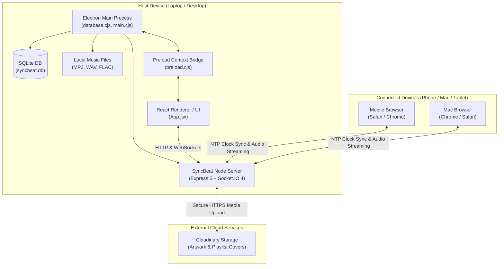
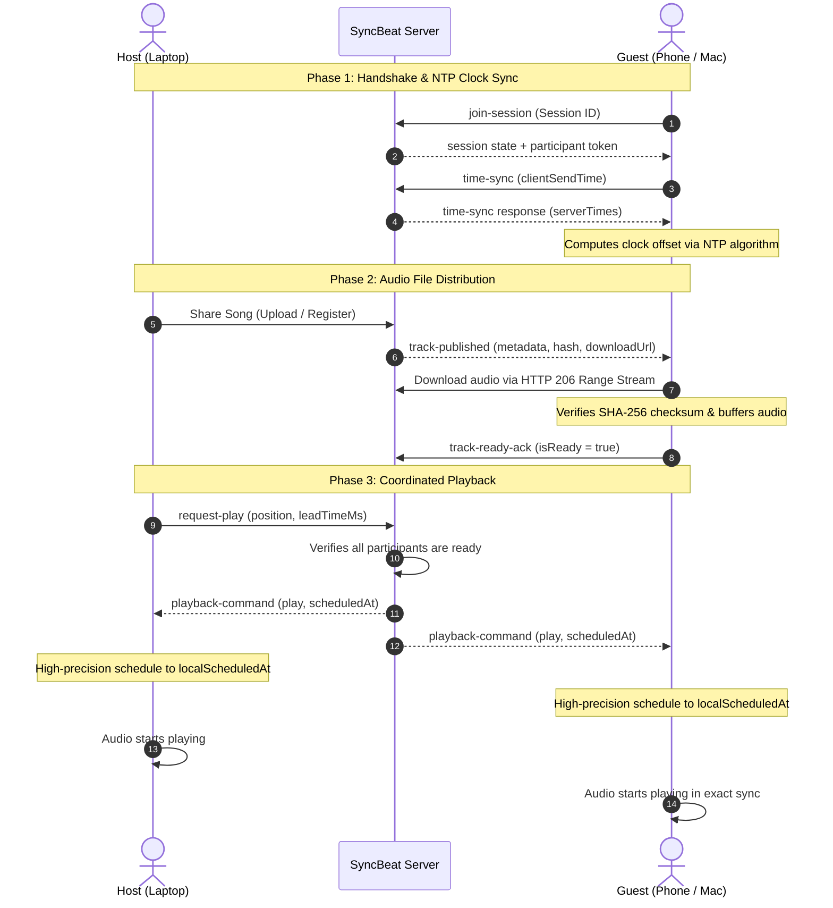

# SyncBeat — System Architecture & Component Design

SyncBeat is a hybrid desktop and cross-device music sharing and synchronized playback application built with **Electron**, **React**, **Vite**, **Express**, **SQLite**, and **Socket.IO**.

---

## 1. High-Level System Architecture

---

## 2. Process & Responsibility Separation

### A. Electron Main Process (`electron/`)
* **Window Lifecycle**: Controls BrowserWindow creation and native application menu.
* **Local Storage & Database**: Interacts directly with `better-sqlite3` to store songs, metadata, and tracks.
* **Native File Dialogs**: Opens OS-native file and folder selection dialogs for audio import (`music-metadata`).
* **Binary File I/O**: Reads audio files safely into Node.js buffers for streaming and hash computation.
* **Server Lifecycle**: Spawns and manages the local synchronization server on port 3001.

### B. Preload Bridge (`electron/preload.cjs`)
* Enforces strict `contextIsolation: true` and `nodeIntegration: false`.
* Exposes a safe, typed subset of IPC calls to the renderer via `window.electronAPI`:
  - `selectMusicFiles()`, `selectMusicFolder()`
  - `getSongs()`, `readMusicFile()`
  - `startLocalServer()`, `stopLocalServer()`, `getLocalServerStatus()`
  - `shareSongToSession()`

### C. Backend Engine (`backend/src/`)
* **`app.cjs`**: Express 5 application setup with centralized CORS middleware, JSON parser, and API routes.
* **`server.cjs`**: Unified server factory binding HTTP server, Express, and Socket.IO.
* **`config/cors.cjs`**: Dynamic origin validation supporting local development, production URLs, and private network hotspot ranges.
* **`config/cloudinary.cjs`**: Official Cloudinary SDK configuration module using secure server-side credentials.
* **`services/sessionManager.cjs`**: In-memory state machine for sessions, participants, track distribution, and resync state.
* **`services/cloudinaryService.cjs`**: Validation, secure upload, and deletion of playlist covers and artwork.
* **`sockets/syncSocket.cjs`**: Socket.IO event handlers for room management, NTP clock synchronization, playback scheduling, and telemetry.

### D. Frontend React Application (`src/`)
* Single-Page Application built with React 19 and Vite 8.
* Reusable service layer:
  - `services/api.js`: Centralized REST API client.
  - `services/socket.js`: Reusable Socket.IO connection manager.
  - `services/mediaService.js`: Cloudinary media upload and status service.
  - `services/musicService.js`: Electron IPC bridge.
* Modular hooks:
  - `hooks/useMusicLibrary.js`: Library import and search.
  - `hooks/useAudioPlayer.js`: Local HTML5 audio playback and element coordination.
  - `hooks/useSyncSession.js`: Real-time session synchronization, NTP clock offset tracking, SHA-256 chunked download verification, pre-buffering readiness, and precise action scheduling.

---

## 3. Playback Synchronization Protocol

---

## 4. Operational Modes

| Feature | Mode A: Online Sessions | Mode B: Offline Local Network |
| :--- | :--- | :--- |
| **Connectivity** | Public Internet / Cloud Hosted | Wi-Fi Hotspot / Local LAN |
| **Access URL** | `https://your-domain.com` | `http://172.20.10.3:5173` or `:3001` |
| **Internet Required** | Yes | **No** (Zero external data needed) |
| **Audio Distribution** | Streaming from host / cloud | HTTP 206 Partial Content over LAN |
| **Media Artwork** | Cloudinary Cloud Storage | Local storage / Cloudinary if online |
